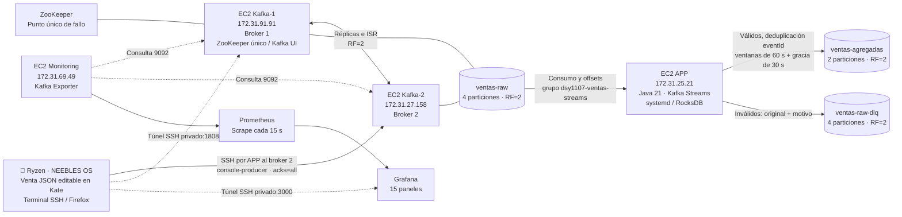

# DSY1107 · EP6 — Arquitectura implementada y conexiones reales

Diagrama de la solución Kafka de la evaluación EP6, correspondiente a la rama `ep5-app`. No representa el sistema Angular/Oracle de evaluaciones anteriores.

## Decisiones que se deben defender

- **Dos brokers:** permiten RF=2, no RF=3; con `min.insync.replicas=1` el laboratorio puede aceptar escrituras durante la caída de uno, a costa de menor redundancia mientras se reconstituye el ISR.
- **ZooKeeper único en Kafka-1:** es un riesgo conocido, por lo que no se afirma alta disponibilidad total del clúster.
- **Kafka Streams en APP:** procesa `ventas-raw`, rechaza JSON inválidos hacia DLQ, reagrupa por `eventId`, deduplica con estado persistente (RocksDB y changelog), y emite agregados por tienda/ventana.
- **Exactly-once-v2:** protege el procesamiento transaccional de offsets/estado/salidas, pero no reemplaza deduplicación de negocio con `eventId`.
- **Ventanas:** 1 minuto + 30 segundos de gracia, aplicadas al `eventTime` del mensaje; un evento válido demasiado tardío se descarta de la agregación, no va a DLQ.
- **Monitoring:** Kafka Exporter consulta brokers, Prometheus captura cada 15 segundos y Grafana visualiza los resultados. No se presenta el lag o los offsets como cifras exclusivas de una venta.
- **Seguridad de acceso:** Kafka UI/Grafana se ven desde Firefox en Ryzen mediante SSH; no abrir puertos administrativos públicamente.

**Nota:** la pauta menciona `arquitectura_encargo.mmd` como diagrama objetivo proporcionado en clases. Ese archivo no se encuentra en esta rama del repositorio. Este diagrama documenta lo implementado; es necesario compararlo con el diagrama original cuando esté disponible.
